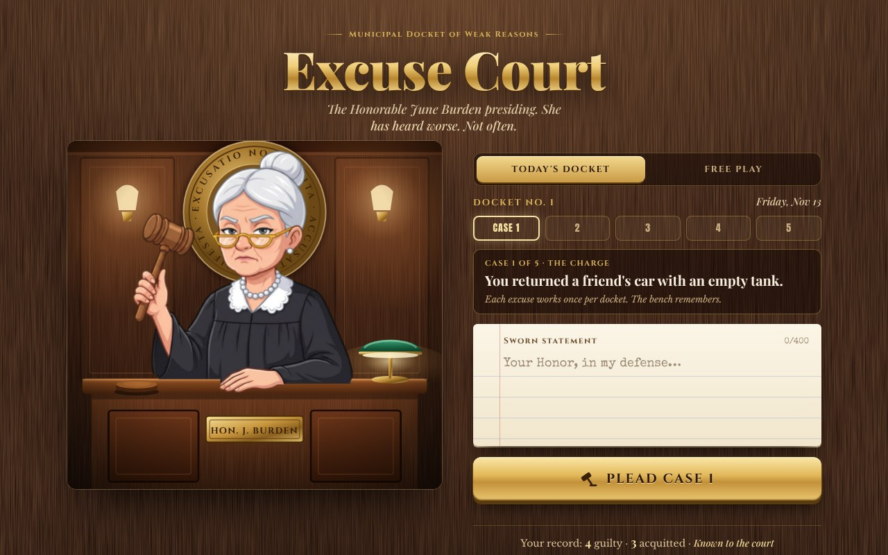

# Excuse Court

**Your excuse is on trial. The judge has heard worse. Not often.**

Type the reason you were late, missed it, or forgot. The Honorable June Burden reads it, bangs the gavel, stamps a ruling (guilty or acquitted), gives it a Believability score and signs it. Then you can share the ruling.

**Today's docket:** five charges a day, the same five for everyone (picked by the date, no server). Plead an excuse for each; every excuse works once per docket, and some just don't fit the charge. Finish for a score like 3 of 5 acquitted and a shareable grid. Your record, rank and days-in-a-row stay on your device. Free play is still there for any excuse you like.

**Play:** https://connabyss.github.io/excuse-court/

One HTML file. Nothing you type is sent anywhere. Sound can be turned off at the bottom of the page.

Made for MLH Global Hack Week (November 2026), built in Cursor, then given a full makeover with Claude Code. The judge illustration is AI-generated (Google Gemini image models); the courtroom, ruling and effects are drawn in code.
